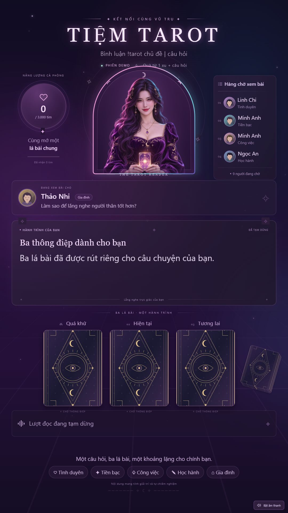

# Kết quả kiểm tra bàn giao — 14/11/2026

## Cập nhật luồng bình luận tự nhiên — 17/11/2026

Bổ sung sửa lỗi admin DEMO không nhập được câu hỏi khi phiên cũ thiếu trạng thái chờ: phục hồi cửa sổ nhập sau khi tiếp tục, nhận biết đúng đang tạo/đọc đáp án và cho soạn nháp trước khi gửi. Đã thử nhập trực tiếp trong trình duyệt; khung chờ overlay có viền sáng hơn và thanh tiến độ đếm ngược rõ hơn.

- `npm test`: **149/149 đạt**, không lỗi hoặc bỏ qua. Bao gồm parser tiếng Việt, mời chọn chủ đề rồi hỏi chi tiết, ưu tiên người tặng quà, đúng ID/phòng, chống lặp, nâng cấu hình cũ và khôi phục sau restart.
- `npm run build`: TypeScript và Vite đạt. Hai script kiểm tra AI đã chuyển sang bình luận thường và được kiểm tra cú pháp; lần cập nhật này không chạy dịch vụ AI thật.
- Hỏi tiếp nhận ba câu nối tiếp bằng bình luận thường, mỗi câu có 30 giây nhập. Đồng hồ dừng khi tạo/đọc đáp án và mở lại sau khi đọc xong. Kiểm thử xác nhận không đổi ba lá, không nhận câu từ tài khoản khác, không nhận dồn câu khi đang trả lời và bỏ kết quả AI cũ sau hủy.
- Đã xem trực tiếp trên Edge ở backend thử riêng: lời mời đúng tên giữa overlay, khung hỏi chi tiết sau khi chỉ chọn chủ đề, hai nửa bộ bài xào xen kẽ, bộ bài xòe và khung hỏi tiếp có đồng hồ 30 giây. Backend thử dùng SQLite riêng và AI giả trỏ localhost, không thay dữ liệu LIVE hoặc gọi API bên ngoài.
- Chưa thử lại quà/bình luận TikFinity hoặc âm thanh OBS trong phiên LIVE thật ở lần cập nhật này. Xem [luồng hiện tại](CONVERSATION-FLOW.md); các mục dưới đây là lịch sử phiên bản trước, gồm cả cú pháp lệnh và hạn hỏi đáp cũ.

## Lịch sử trước luồng bình luận tự nhiên

Kết quả từng lần kiểm tra nằm trong mục tương ứng. Các mục cũ được giữ làm lịch sử; số lượng kiểm thử, trạng thái server và kết quả API thật trong đó không phải kết quả của lần cập nhật mới.

## Hỏi đáp sau trải bài và bình luận lặp

- Lời giải chính vẫn đầy đủ, mặc định tối đa **65/50 từ**. Nội dung thô của AI cần tối thiểu **45/35 từ**; nếu vượt trần thì chỉ giữ các câu hoàn chỉnh, tối thiểu **30/20 từ** sau cắt. Không cắt dở từ như “quyết…”. Prompt yêu cầu trả lời thẳng, dùng từ thông dụng, mỗi câu một ý, có gợi ý cụ thể; tránh thuật ngữ, ẩn dụ khó hiểu, lời đệm và lặp lại. Fallback giữ nguyên.
- Khi bật AI, backend có cấu hình AI và `followUpEnabled=true`, lượt cá nhân mở hỏi đáp sau tổng kết. Đúng tài khoản vừa xem gửi riêng **`!hoi`**, rồi viết câu hỏi ở bình luận tiếp theo. Lệnh riêng chỉ mở trạng thái chờ, chưa gọi AI hay dùng suất câu hỏi. Tối đa **3 câu khác nhau**, dựa trên ba lá/chiều/vị trí, lời giải và các câu trả lời trước của người đó. Không rút lại bài hoặc dùng nội dung của người khác. Lượt chung từ tim không mở hỏi đáp.
- `followUpWindowSec` mặc định **120**, hợp lệ từ **30 đến 120 giây**. Đây là hạn tuyệt đối từ lúc mở hỏi đáp, vẫn chạy khi tạm dừng. Admin có thể nhập giúp câu hỏi và thử lại câu lỗi khi lượt đang chạy; nút kết thúc sớm dùng được cả khi tạm dừng. Đủ ba câu đã trả lời hoặc hết hạn thì hoàn tất; hàng chờ tiếp tục theo cấu hình tự chuyển/thủ công.
- Câu hỏi lỗi giữ nguyên suất đã dùng. Thử lại sau ít nhất **5 giây**, tối đa **ba lần thử tính cả lần đầu** cho mỗi câu; hạn thời gian không được gia hạn. Lỗi không sinh câu trả lời giả. Credit/quy tắc quà giữ nguyên, hỏi đáp không dùng thêm quà.
- Chat thiếu `msgId` được lọc dự phòng bằng hash ID tài khoản + phòng + nội dung trong **5 giây**. Riêng lệnh `!hoi` đứng một mình chỉ đặt cờ chờ nên có thể lặp nhanh cho câu kế tiếp, không gia hạn deadline. Đây là chống lặp có giới hạn, không thay được ID sự kiện thật và không áp dụng để chốt giao dịch quà. Cùng tài khoản/phòng gửi lại đúng chủ đề và câu hỏi sau khi hoàn tất bị chặn tạo lượt mới trong **120 giây**, kể cả có `msgId` mới; câu hỏi khác vẫn theo cooldown thông thường.

Kết quả tự động cuối: **117/117 kiểm thử đạt**, không lỗi, không bỏ qua; `npm run build` gồm TypeScript và Vite đạt. Đã nạp bản chạy khi LIVE/DEMO rảnh, xác nhận hàng chờ, credit, cấu hình giọng/nhạc/AI giữ nguyên, hỏi đáp bật ở 120 giây và nguồn âm thanh LIVE trở về overlay.

Phạm vi kiểm thử bổ sung:

- **15 kiểm thử engine** trong [followup-engine.test.ts](../tests/followup-engine.test.ts): giữ ba lá và xử lý ba câu nối tiếp; sai người/sai lượt/câu thứ tư/câu lặp; AI lỗi và giới hạn thử lại; hạn tuyệt đối khi tạm dừng; admin kết thúc khi tạm dừng; bỏ kết quả AI muộn sau kết thúc/skip; phục hồi sau restart; lặp lệnh sau hoàn tất; nhận `!hoi` từ đúng ID và bỏ frame thiếu `msgId` lặp; kiểm tra phòng hiện tại khi thiếu `roomId`. Bốn regression mới kiểm tra gửi riêng `!hoi` rồi bình luận câu hỏi, gồm ba trigger thiếu msgId cùng thời điểm, AI đang bận, input lỗi giữ chờ, người/phòng khác không tiêu thụ cờ, và max3/end/timeout không mở lại.
- **7 kiểm thử chat guard** trong [chat-guard.test.ts](../tests/chat-guard.test.ts): cửa sổ hash 5 giây, chuẩn hóa NFC/hoa thường/khoảng trắng, phân biệt ID/phòng/câu hỏi, ưu tiên `msgId` thật, cửa sổ 120 giây sau hoàn tất, trạng thái lịch sử và dọn hash hết hạn. Gửi lặp không kéo dài hạn chặn.
- **7 kiểm thử provider/TTS hỏi tiếp** trong [followup-provider.test.ts](../tests/followup-provider.test.ts): ngữ cảnh đúng ba lá và lịch sử riêng, giới hạn đầu vào, câu hỏi chứa chỉ dẫn, cắt lời đáp dài tại câu hoàn chỉnh, JSON/schema/nội dung không hợp lệ, lỗi và hủy an toàn, TTS chỉ đọc câu trả lời hiện tại. Các kiểm thử dùng provider mô phỏng; không phải kết quả gọi Gemini hoặc TTS thật.
- **3 kiểm thử audio hỏi đáp** trong [followup-audio.test.ts](../tests/followup-audio.test.ts): mỗi câu trả lời có cursor riêng, pause/resume giữ tiến độ đúng câu và pha chờ không đọc lại nội dung cũ. Thêm kiểm thử adapter về cảnh báo thiếu `msgId` và kiểm thử engine về phòng hiện tại khi frame không ghi `roomId`.

- **Gemini thật**, backend/database riêng tại 54323, chỉ dữ liệu tự tạo: lời giải chính trong **3.108 ms**, ba lá **51/58/57 từ**, tổng kết **43 từ**; ba câu trả lời **69/58/59 từ**, lần lượt **1.258/1.402/1.406 ms**. Bốn request, giữ nguyên bài và lời giải gốc; sai người, frame `!hoi` lặp thiếu msgId và câu thứ tư đều bị chặn. Hoàn tất và lưu lịch sử đúng. [Kết quả không chứa khóa](../qa/followup-feature.json); chạy lại `node scripts/check-followup-feature.mjs`.
- Trên Edge, admin hiển thị trạng thái 3/3 đã trả lời trong lịch sử; overlay hiện đúng người, đếm ngược và ba lá cũ. Đã bật nguồn overlay DEMO và quan sát một câu trả lời đọc tới trạng thái **Đã đọc trọn nội dung**. Các câu còn lại kiểm tra qua API và regression audio; đây không phải bản ghi loa hay phép đo OBS. [Lịch sử ba câu](../qa/followup-admin.jpg), [overlay chờ hỏi tiếp](../qa/followup-overlay.jpg).
- Lần thử đầu gặp HTTP 5xx từ dịch vụ AI; lần kiểm tra thành công cuối ở trên không có lỗi. Mẫu thật đã giúp phát hiện và sửa cắt dở câu, lời khuyên lặp và một lỗi chính tả; không sửa trực tiếp các câu trong log để tạo kết quả đẹp.

---

## Lịch sử kiểm tra trước cập nhật hỏi đáp

## Khôi phục lời giải AI đầy đủ

- Đã bỏ yêu cầu viết hai câu ngắn và khôi phục prompt giải thích đầy đủ ý nghĩa lá/chiều, vị trí, bối cảnh câu hỏi và gợi ý thực tế. Mặc định và cấu hình đang dùng trở lại **65 từ mỗi lá, 50 từ tổng kết**; mức tối thiểu 45/35, tối đa có thể chỉnh 70/55.
- Khôi phục fallback đầy đủ. Cấu hình ngắn 30/25 đã lưu tự nâng về 65/50 khi khởi động; nội dung của lượt cũ đã chốt được giữ nguyên, lượt mới dùng chế độ đầy đủ.
- Gemini thật trả `source=ai` trong **3.133 ms**, ba lá 46/46/65 từ, tổng kết 36 từ; đúng 1 request, giữ nguyên lá/vị trí/chiều và chữ trùng lời đọc. [Log khôi phục đầy đủ](../qa/ai-full-restored-check.json).
- `npm test`: **82/82 đạt**, gồm từ chối nội dung AI quá ngắn và nâng cấu hình đã lưu; build/typecheck đạt. Đã nạp bản chạy và xác nhận admin ở mức 65/50. [Ảnh cấu hình](../qa/ai-full-restored-settings.jpg).

## Lời giải AI tóm tắt hơn (lịch sử, đã tắt)

- Mặc định và cấu hình đang dùng: tối đa 30 từ mỗi lá, 25 từ tổng kết. Prompt yêu cầu mỗi lá 20–30 từ, thường hai câu ngắn gồm ý nghĩa chính và một gợi ý; tổng kết 15–25 từ. Giọng đọc dùng đúng cùng nội dung ngắn với chữ hiển thị.
- Cho phép chỉnh giới hạn mỗi lá 20–70, tổng kết 15–55; cấu hình dài cũ vẫn hợp lệ. Fallback ngắn vẫn giữ tên/chiều lá và gợi ý theo chủ đề; đã kiểm tra đủ 78 lá × 5 chủ đề × 2 chiều, kể cả các giới hạn thấp.
- Gemini thật trên backend/database riêng trả `source=ai` sau **2.712 ms**: ba lá 29/28/29 từ, tổng kết 23 từ, đúng 1 request; cardId/vị trí/chiều giữ nguyên, chữ trùng lời đọc. Khi tắt AI vẫn không gọi API. [Log riêng cho nội dung ngắn](../qa/ai-concise-check.json).
- `npm test`: **82/82 đạt**; build/typecheck đạt. Bộ kiểm thử TTS dài dùng cấu hình dài rõ ràng để tiếp tục kiểm tra chia nhóm câu/caching; nội dung ngắn được kiểm tra riêng. Đã lưu giới hạn mới lên server đang dùng và nạp lại admin/overlay. [Ảnh cấu hình](../qa/ai-concise-settings.jpg).

## Một lượt DEMO mới có AI và âm thanh đầy đủ

- Đã chạy bằng nút **Chạy một lượt demo** trên ứng dụng đang dùng, sau khi kết thúc lượt fallback cũ và tạm tắt tự chuyển. Lượt mới `49207efa-3d7b-4339-a374-65f98d0086db` đi tự nhiên qua đủ 8 pha và có trạng thái `completed` sau **76,4 giây**, không tua bước.
- Nguồn lời giải **AI cá nhân hóa**: Bốn Gậy ngược, Vua Cốc ngược, Kỵ Sĩ Cốc xuôi giữ đúng ID/thứ tự/chiều; nội dung bám câu hỏi mẫu về tình duyên. Mỗi lá 64/61/57 từ, tổng kết 50 từ; chữ hiển thị trùng lời đọc. [Ảnh AI được xác nhận](../qa/demo-ai-confirmed.jpg), [ảnh lời giải trên overlay](../qa/demo-ai-reading.jpg).
- Giọng **Microsoft Hoài My Online (Natural)** trên overlay có tiến độ `boundary` thực ở cả ba lá và tổng kết (65/62/58/51 cập nhật), tín hiệu âm thanh hoạt động ở đủ 4 đoạn và báo đọc xong. Không ghi nhận lỗi. Xào/lật bật ở 0,7, nhạc tarot ở 0,2 trong toàn lượt. Đây là tiến độ/cấu hình trình duyệt, chưa phải bản ghi hoặc số đo loa/OBS. [Log toàn lượt](../qa/demo-ai-av-check.json).
- Dòng fallback người dùng nhìn thấy thuộc lượt bắt đầu lúc **19:37:36** trước khi backend nạp khóa Gemini; lỗi được ghi ngay sau 4 ms. Lượt đã chốt không tự tạo lại nội dung khi sửa cấu hình. Nút DEMO khi còn lượt đang tạm dừng chỉ thêm mẫu vào hàng chờ, không thay lượt đó. Đã dọn bốn mẫu chưa chạy đi kèm bài kiểm tra và khôi phục tự chuyển ban đầu.
- Giao diện mới phân biệt **Đang tạo lời giải AI…**, **AI cá nhân hóa** và fallback, đồng thời giải thích cấu hình mới áp dụng cho lượt kế tiếp. Backend báo nguyên nhân an toàn riêng cho thiếu cấu hình, quyền/khóa, hạn mức, timeout, JSON/nội dung hoặc kết nối; không phản chiếu body/lỗi thô có thể chứa khóa.
- Bổ sung 6 hồi quy AI: phân loại lỗi, pending và tiếp tục yêu cầu AI bị hủy ở pha chuẩn bị mà giữ nguyên ba lá. `npm test`: **77/77 đạt**; build/typecheck đạt. Bản sửa đã nạp lên server sau khi lượt kiểm tra hoàn tất.

## Âm xào bài, nhạc tarot và Gemini

- Thay bíp rất nhỏ bằng file xào bài 2,4 giây và chia/lật 0,38 giây; pha xào lặp đủ thời gian, hủy khi tạm dừng/đổi pha/mất quyền. Có `sfxVolume` riêng, không giảm theo âm lượng giọng.
- Thêm nhạc tarot gốc 64 giây stereo, hòa âm chuyển chậm với tiếng gảy/chuông thưa và đuôi vang nối vòng. Ba WAV đều local, PCM không clip; [nguồn gốc, số đo và cách tạo lại](AUDIO-ASSETS.md). Nhạc hạ còn 40% khi có lời đọc, không tạo loop trùng khi chỉnh âm lượng, dừng khi mất quyền/kết nối.
- Đã áp dụng cấu hình đang dùng: nhạc bật ở 0,2; xào/lật bật ở 0,7. Backend đã khởi động lại để nhận khóa Gemini, model mặc định `gemini-3.5-flash-lite`; so sánh trước/sau xác nhận giữ readingId, ba lá, trạng thái tạm dừng, hàng chờ và số credit.
- `npm test`: **71/71 đạt**, gồm 11 kiểm thử soundscape và hồi quy cấu hình âm lượng độc lập; `npm run build` gồm typecheck đạt. Các file WAV trả HTTP 200 và `audio/wav` qua server production.
- **Dùng AI cá nhân hóa** đã được kiểm tra bằng Gemini thật trên backend/database riêng với dữ liệu DEMO tự tạo: tắt AI dùng fallback và 0 request; bật AI tạo `source=ai` trong **3.076 ms**, đúng 1 request. Ba lá/chiều/vị trí giữ nguyên, lời giải 65/61/58 từ và tổng kết 36 từ. [Kết quả không chứa khóa](../qa/ai-feature-check.json); chạy lại bằng `node scripts/check-ai-feature.mjs`.
- Server đang dùng đã xác nhận `capabilities.ai=true`, AI bật và model đúng. Lượt cũ đang tạm dừng vẫn giữ nội dung fallback đã chốt; AI áp dụng cho lượt mới, không thay lời giải giữa lượt.
- Đã bấm nghe thử trên Edge: xào bài kết thúc với trạng thái **Đã phát thử tiếng xào bài**, nhạc 12 giây kết thúc với **Đã phát thử nhạc nền tarot**, cả hai tự trả quyền. Sau đó đã bật lại nguồn overlay DEMO; server và admin xác nhận **Đang phát nhạc nền tarot**, admin không giữ nguồn. [Ảnh cấu hình đang áp dụng](../qa/audio-music-ai-settings.jpg). Chưa thay thế kiểm tra loa/meter ở OBS hoặc LIVE Studio.

## Chuyển nguồn âm thanh sang overlay

- Sửa lỗi admin giữ quyền sau khi kiểm tra giọng: giọng thử tự trả quyền khi kết thúc, lỗi, hết thời gian chờ hoặc bắt đầu/tiếp tục lượt đọc. Giọng thử không tự bật nhạc, SFX hay lời đọc của lượt.
- Overlay luôn có nút khi chưa giữ nguồn âm thanh; nếu tab khác cùng phiên đang giữ nguồn, hiển thị **Chuyển âm thanh sang overlay này**. Chỉ thao tác chuyển rõ ràng mới thay nguồn; vẫn giữ một nguồn trong toàn ứng dụng và không giành quyền từ phiên LIVE/DEMO khác.
- Tín hiệu muộn và phản hồi TTS HTTP của nguồn cũ không được thay đổi nguồn mới. Có thời gian chờ cho overlay bắt đầu phát để tránh chuyển lá ngay giữa thao tác đổi nguồn.
- `npm test`: **59/59 đạt**; `npm run build` gồm typecheck đạt. Regression bao phủ chuyển nguồn, chặn claim thường/xuyên phiên, giữ pha trong lúc chuyển, tín hiệu muộn của nguồn cũ và request TTS đang chờ.
- Đã kiểm tra trên Edge: giọng thử tại admin kết thúc thành công và trả quyền; bật tiếng lâu dài tại admin làm xuất hiện nút chuyển trên overlay; bấm chuyển đưa quyền sang overlay, admin trở lại im lặng. [Ảnh nút chuyển trên overlay](../qa/audio-overlay-transfer.jpg). Phiên kiểm tra dùng cổng/database riêng và âm lượng 0 để không chồng tiếng với phiên người dùng.
- Sau khi áp dụng lên cổng 3210, overlay DEMO đang phát có `audioActive=true`, giọng Microsoft An và tiến độ `boundary` thực từ trình duyệt; admin hiển thị nguồn âm thanh ở tab khác. Các kiểm tra này không thay cho xác nhận meter/thu tiếng trên OBS hoặc LIVE Studio.

## Launcher tự cài trên Windows

- `START.bat` và `START.cmd` tự cài Node.js 24 kèm npm vào `.runtime/node` nếu thiếu bộ công cụ phù hợp; bản tải từ nodejs.org được kiểm tra SHA-256. Thiếu thư viện thì tự chạy `npm install --include=dev` trước khi build.
- Windows PowerShell 5.1: **11/11 kiểm tra launcher đạt**, gồm bộ công cụ có sẵn/cache, thiếu npm/Node cũ, lỗi tải/hash, cài thư viện đúng thư mục, bỏ qua khi đủ, mã lỗi npm và cài xong vẫn thiếu file. Chạy lại bằng `scripts/TEST-WINDOWS-SETUP.ps1`, không cần mạng.
- Đã thử tải thật khi ẩn Node/npm khỏi PATH: Node **24.22.3**, npm **11.19.1** chạy được và được dùng lại từ cache. Đã thử launcher từ trạng thái thiếu `node_modules`: tự cài thư viện, typecheck/build đạt, backend chạy trên cổng kiểm tra 54321, `/admin` trả HTTP 200 và API DEMO hợp lệ. Đã xác nhận dùng lại server đang chạy khi Node/npm không nằm trong PATH.
- Kiểm tra khởi động dùng database riêng trong `tmp/` và không mở trình duyệt. Lần cài đầu cần kết nối mạng; lỗi tải/cài đặt dừng launcher với thông báo để thử lại.

## Bộ bài thật và lời đọc liên tục

- Đủ 78 JPEG Rider–Waite–Smith Pam-A, rộng 500 px, lưu local, không tải từ mạng khi phát. Manifest kiểm tra hash của từng ảnh, nguồn đúng cardId, 22/56 lá, Strength VIII/Justice XI và 16 lá court. Đã xem trực tiếp The Fool, Page of Cups, Four of Pentacles và bài đang lật/ngược trên sân khấu. Nguồn ở [RWS-SOURCES.md](RWS-SOURCES.md).
- Đã bỏ chia cứng 24 từ. Mỗi lá/tổng kết dùng một utterance hoặc một file TTS cho cả đoạn; cả đoạn giữ nguyên trong DOM và khung tự cuộn theo câu. Phụ đề cũng cuộn câu dài, không dùng dấu ba chấm để giấu phần còn lại. Đọc xong thật chuyển sau 800 ms; timer mẫu không cắt lời và không bắt chờ đủ 24 giây khi đã đọc xong.
- Kiểm thử thêm: một lần phát toàn đoạn, pause/resume native, khôi phục từ đầu câu khi resume lỗi/treo, giới hạn chờ giọng bắt đầu, không lặp phục hồi vô hạn, HTTP TTS một file, callback cũ sau skip, heartbeat/hạn cứng, phân đoạn tiếng Việt và đủ 78 artwork. [Log 58 kiểm thử](../qa/test-results.txt).
- Đã thử thật trên Edge với giọng **Microsoft Hoài My Online (Natural)** đang cấu hình. Tiến độ `boundary` chạy qua nhiều câu, pause/resume tiếp tục đến hết lá 3 rồi sang tổng kết. Đã gặp một lần native resume im lặng; bản sửa có watchdog 2,5 giây để đọc lại nguyên câu một lần, và bỏ giữ sân khấu nếu giọng vẫn không chạy. Kiểm thử mô phỏng tái hiện cả hai trường hợp này; [log thử resume trên Edge](../qa/audio-continuity-check.json).
- Lượt mới từ đầu đến cuối trên bản sửa đã hoàn tất trong **70,9 giây**, qua đủ 8 pha locking/shuffling/dealing/card1/card2/card3/summary/complete, trạng thái hàng chờ `completed`, có boundary giọng thật và không có audio-error. Ba lá giữ nguyên The Fool ngược, Nine of Swords xuôi, Ten of Wands xuôi. [Log đầy đủ](../qa/continuity-result.json). Toàn bộ 78 ảnh cũng trả HTTP 200 và khớp SHA-256 qua server production.
- Kiểm tra sân khấu **1080 × 1920**: ảnh `object-fit: contain`, không ảnh lỗi, tên/chiều khớp hình. Toàn bộ đoạn đang đọc có trong khung. Font mặc định: khung lời giải 202 px đủ nội dung mẫu; font 1,15 với safeTop 80 / safeBottom 100 / safeX 80: đoạn dài cuộn 22 px đến cuối, footer ở y=1820 đúng vùng an toàn. Đã trả cấu hình về giá trị người dùng trước kiểm tra.
- Bản build tại lần kiểm tra này: JavaScript 347,93 KB / 107,79 KB gzip; CSS 45,51 KB / 11,12 KB gzip; tài sản bài local khoảng 16,28 MB. Console có lỗi mạng của script extension AdBlock360; không thay extension và không coi console toàn bộ trình duyệt là sạch.
- Việc nhận tiến độ/kết thúc giọng trên Edge không thay cho xác nhận nghe qua loa, meter OBS hoặc nguồn phát LIVE Studio. TikFinity LIVE thật và dịch vụ HTTP TTS thật vẫn cần thử tại môi trường phát. Gemini backend đã cấu hình và lượt mẫu đang dùng nội dung AI; không đưa key vào source ZIP.
- Sau kiểm tra: production vẫn chạy, LIVE không có dữ liệu thử, DEMO có 7 lượt sẵn sàng và không có lượt đang đọc; đã nhả quyền âm thanh của tab thử. Cỡ chữ/vùng an toàn đã về cấu hình trước kiểm tra, viewport kiểm tra đã trả về kích thước trình duyệt bình thường. Bấm **Bật âm thanh** trên đúng overlay sẽ phát trước khi bắt đầu lượt tiếp theo.

Ảnh bản mới: [đang đọc bài](../qa/rws-reading.jpg), [chữ lớn và bài ngược](../qa/rws-large-text.jpg), [chữ cuộn đến cuối câu](../qa/rws-continuous-text.jpg). Kết quả lượt kiểm tra đầy đủ lưu tại [continuity-result.json](../qa/continuity-result.json).

## Cập nhật font và Gemini

- Chuỗi nguồn `Đang đợi một lời nhắn` đúng chuẩn NFC. Đã thay font tiêu đề Georgia bằng Lora local có giấy phép OFL, chỉnh kerning/giãn chữ/line-height. Kiểm tra 154 ký tự chữ dùng trong giao diện/bộ bài: đầy đủ glyph.
- Đã refresh overlay LIVE trên Edge đang dùng, chờ `document.fonts.ready`, xác nhận computed font là Lora Tarot và font đã nạp. Ảnh đối chiếu: [vietnamese-font-fixed.jpg](../qa/vietnamese-font-fixed.jpg).
- Key Gemini được lưu riêng tại `backend/.env`; kiểm tra danh sách model thành công. Không có key trong snapshot hoặc file xuất cấu hình. Source ZIP tiếp tục loại `.env`, database và runtime data.
- Đã bật `gemini-3.5-flash-lite`, timeout 30 giây. Kiểm tra provider trực tiếp thành công; lượt qua API/state machine đang chạy cũng sinh lời giải AI hợp lệ sau **3.023 ms**, giữ đúng 3 lá/vị trí/chiều, các đoạn 57/55/52 từ, tổng kết 49 từ. Kết quả không chứa secret ở [gemini-check.json](../qa/gemini-check.json).
- Đã sửa race khiến AI chậm hơn animation bị bỏ qua trước lá đầu. Hai regression test kiểm tra phản hồi chậm hợp lệ và provider quá hạn/không hợp tác. Một test bổ sung kiểm tra rút gọn nội dung dài có kiểm soát, giữ lời đọc khớp chữ.
- `npm test`: **41/41 đạt**; `npm run build` gồm typecheck đạt.
- Console Edge có thông báo lỗi mạng từ script của extension AdBlock360; không thay đổi extension hoặc thiết lập trình duyệt. Phần kiểm tra font thành công không được hiểu là console của toàn bộ trình duyệt không có thông báo từ extension.

---

Đã chạy trên môi trường Windows của phiên làm việc, Node 24.18.0, npm 11.16.0. Thư mục ban đầu trống; không có AGENTS.md tại project hoặc các cấp cha đã kiểm tra.

## Build và kiểm thử

- `npm install`: thành công; 75 package được cài, audit không báo lỗ hổng tại thời điểm cài.
- `npm run typecheck`: đạt.
- `npm run build`: đạt; Vite 7.3.8, bản frontend khoảng 339 KB JavaScript / 105.5 KB gzip và 42.6 KB CSS / 10.5 KB gzip; artwork phục vụ local riêng.
- `npm test`: **38/38 đạt**, không bỏ qua bài nào. Log lần cuối ở [qa/test-results.txt](../qa/test-results.txt).
- Launcher Windows PowerShell 5 được chạy thật với `-NoBrowser -KeepAlive`: build và khởi động production thành công. Đã sửa UTF-8 BOM và bỏ phụ thuộc CIM khi kiểm tra cổng. `START.cmd` dùng cùng launcher với `-KeepAlive`, đồng thời mở admin.

## Các rủi ro chính

| Yêu cầu | Kết quả và phạm vi chứng minh |
| --- | --- |
| Demo không có TikFinity/API key | Đạt. Một lượt chạy hết bằng timer thực trong **136,3 giây** và được ghi hoàn tất; sau đó có thêm một lượt hoàn tất. Phiên LIVE vẫn trống. |
| Sân khấu dọc, không tràn | Đạt trong trình duyệt kiểm tra: canvas và ba ảnh chính đúng **1080 × 1920**. Lời giải đang đọc có scrollHeight bằng clientHeight; câu hỏi dài được giới hạn có chủ đích ở hai dòng. |
| 10 tài khoản, trùng nickname | Test ghép đúng ID, avatar, chủ đề, câu hỏi và quà; mỗi người một lượt chưa xong. Hai Minh Anh có ID riêng. |
| Quà trước/sau, cửa sổ ghép | Đạt. Credit quá cửa sổ ghép còn lưu để admin đối soát; quà khi đang đọc dành cho yêu cầu mới. |
| Combo và phát lại | Dãy 1 → 2 → 3 → final 3 chỉ cấp 3 quà; lặp event và final khác msgId nhưng cùng combo không cấp lại. Quà khác giao dịch không bị gộp theo giftId. |
| Tim, baseline và mốc | Đạt với delta, tổng tích lũy, frame đến muộn, đổi phòng, phần dư, cooldown, giới hạn pending và thay heartGoal. Không dùng lại tim đã tiêu thụ. |
| Ba lá cố định | Đạt: ba ID khác nhau, thứ tự/chiều/nội dung nhất quán. Bộ 78 lá, tất cả asset local và ma trận 5 chủ đề × 2 chiều tại 45/65/70 từ đã được kiểm tra. |
| Refresh/reconnect/restart | Test HTTP/WS và restart SQLite đạt. Ngoài test, đã restart backend production đang dùng: **cùng readingId, cards, queue, credits**, phục hồi **paused=true**, audio owner rỗng. Kết quả ở [qa/restart-result.json](../qa/restart-result.json). |
| AI/TTS lỗi và tác vụ cũ | Mock HTTP kiểm tra timeout AI thật, phản hồi sai lá/chiều, TTS sai MIME, đoạn TTS trùng chỉ gọi provider một lần, sai owner, đoạn cũ sau pause/skip bị từ chối. Fallback giữ đúng các lá đã chốt. |
| Nhiều tab và một nguồn âm | Test một owner toàn ứng dụng; nhiều GET/preview không bắt đầu lượt, không rút bài hoặc nhận loa. Đã mở nhiều tab thật; admin/preview không tự bật tiếng. |

## Kiểm tra giao diện và vận hành thực tế

- Đã thao tác sửa/lưu câu hỏi, bỏ qua một lượt và hoàn đúng credit của `demo-user-2` trong UI. Sổ credit báo 1 xu chưa dùng và không tự tạo lượt tiếp theo.
- Đã thử pause, resume, chuyển bước DEMO và skip. Sau restart, tiếp tục lượt đã lưu mà không đổi bộ ba lá.
- Đã thử câu hỏi 210 ký tự, fontScale 1.15, safeTop 80 / safeBottom 100 / safeX 80. Main text còn trong khung; footer nằm tại y=1820, đúng giới hạn dưới. Câu hỏi rút gọn hai dòng, bản đầy đủ vẫn có ở admin/backend.
- Admin được kiểm tra ở viewport 1440 × 1080 và 390 × 844. Ở viewport mobile, body scrollWidth 375 ≤ innerWidth 390, không có tràn ngang toàn trang. Ảnh full-page bỏ phần scrollbar nên có chiều rộng 1425/375.
- Bản production trả HTTP 200. Vòng reload được theo dõi có 10 response, không có HTTP ≥400 hoặc loadingFailed; console không có warning/error trong vòng kiểm tra đó. Không có ảnh tải lỗi sau khi tài sản đã nạp.
- Danh sách giọng `vi-*` trong môi trường trình duyệt kiểm tra trả rỗng tại lần truy vấn. Đã thử quyền bật âm thanh; **chưa xác nhận nghe được giọng Việt trên loa Windows/OBS/LIVE Studio**. Không coi trạng thái HTTP mock TTS là kiểm chứng dịch vụ giọng thật.
- Hạt sáng giới hạn 35; có giảm chuyển động và nhịp animation 30/60. Chưa đo FPS bằng profiler trong OBS hoặc chạy tải nhiều giờ.

## Ảnh chụp

| Chờ | Chia ba lá, giữ tạm dừng để kiểm tra | Đang đọc lá 1, bài ngược |
| --- | --- | --- |
|  |  |  |

- [Admin desktop](../qa/admin-desktop.jpg)
- [Admin mobile](../qa/admin-mobile.jpg)
- [Chữ lớn và câu hỏi dài](../qa/overlay-large-text.jpg)
- [Xào bài](../qa/overlay-shuffling.jpg)

## Còn phải xác nhận tại buổi phát

TikFinity thật hiện chưa kết nối trong môi trường kiểm tra; không nhận payload từ một phiên LIVE. Cần đối chiếu chat, gift, combo, like và ID thực theo phiên bản Desktop đang dùng. Adapter và fixture dựa trên [tài liệu đã đọc](PROTOCOL.md), không được coi là cam kết mọi bản TikFinity có cùng schema.

Các lần kiểm tra Gemini thật đã có kết quả ở những mục lịch sử phía trên; chúng không chứng minh cấu hình hoặc hạn mức của dịch vụ ở lần chạy tiếp theo. Dịch vụ HTTP TTS thật vẫn cần thử tại đúng nguồn phát. Không mặc định Windows hoặc OBS có giọng Việt. Kiểm tra âm lượng, quyền autoplay và tránh thu trùng âm Browser Source/desktop trước khi LIVE.

Ảnh tham chiếu không xuất hiện trong đầu vào của phiên làm việc. Bố cục được dựng từ mô tả, chưa thể so khớp ảnh gốc từng chi tiết. Artwork mặc định hiện gồm nhân vật tạo riêng và 78 ảnh quét Rider–Waite–Smith lưu local; SVG biểu tượng đời đầu chỉ còn để tham khảo. Nguồn ở [RWS-SOURCES.md](RWS-SOURCES.md), [ASSETS.md](../ASSETS.md) và prompt liên quan.

Nếu Codex chạy từ xa, localhost trong Codex không phải localhost của máy phát; không thể tự xác minh TikFinity trên máy Windows khác bằng các kết quả này.

Trạng thái server, hàng chờ và nguồn âm thanh thay đổi trong lúc sử dụng; kiểm tra snapshot hiện tại trong admin trước khi bắt đầu. Các số lượng DEMO và trạng thái âm thanh được ghi ở các mục lịch sử chỉ đúng tại thời điểm kiểm tra đó.
