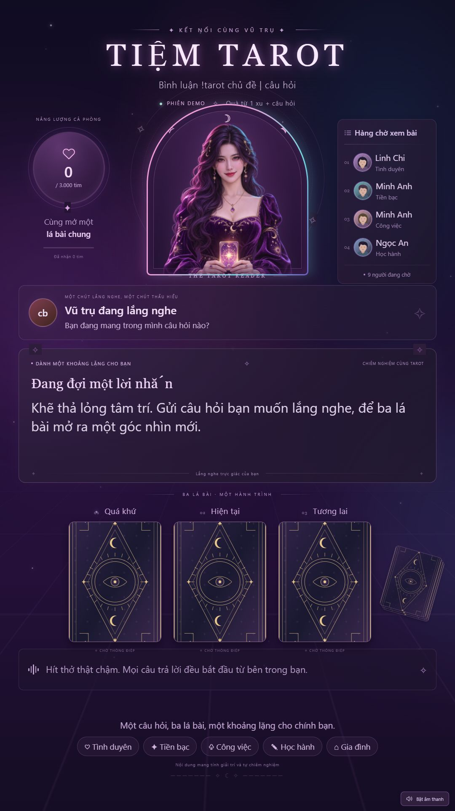
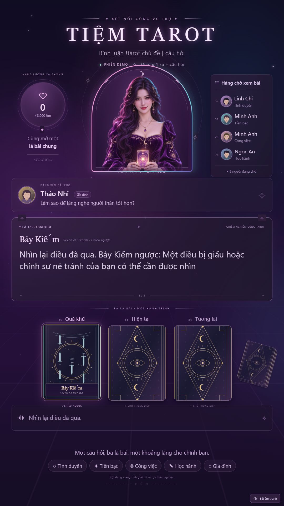

# Kết quả kiểm tra bàn giao — 14/11/2026

**Cập nhật mới nhất: bộ bài RWS thật và lời đọc liên tục; 58/58 kiểm thử đạt, build/typecheck đạt.** Các mục cũ bên dưới được giữ làm lịch sử; số liệu và giới hạn mới trong mục này thay thế những mô tả tương ứng ở lần bàn giao đầu.

## Bộ bài thật và lời đọc liên tục

- Đủ 78 JPEG Rider–Waite–Smith Pam-A, rộng 500 px, lưu local, không tải từ mạng khi phát. Manifest kiểm tra hash của từng ảnh, nguồn đúng cardId, 22/56 lá, Strength VIII/Justice XI và 16 lá court. Đã xem trực tiếp The Fool, Page of Cups, Four of Pentacles và bài đang lật/ngược trên sân khấu. Nguồn ở [RWS-SOURCES.md](RWS-SOURCES.md).
- Đã bỏ chia cứng 24 từ. Mỗi lá/tổng kết dùng một utterance hoặc một file TTS cho cả đoạn; cả đoạn giữ nguyên trong DOM và khung tự cuộn theo câu. Phụ đề cũng cuộn câu dài, không dùng dấu ba chấm để giấu phần còn lại. Đọc xong thật chuyển sau 800 ms; timer mẫu không cắt lời và không bắt chờ đủ 24 giây khi đã đọc xong.
- Kiểm thử thêm: một lần phát toàn đoạn, pause/resume native, khôi phục từ đầu câu khi resume lỗi/treo, giới hạn chờ giọng bắt đầu, không lặp phục hồi vô hạn, HTTP TTS một file, callback cũ sau skip, heartbeat/hạn cứng, phân đoạn tiếng Việt và đủ 78 artwork. [Log 58 kiểm thử](../qa/test-results.txt).
- Đã thử thật trên Edge với giọng **Microsoft Hoài My Online (Natural)** đang cấu hình. Tiến độ `boundary` chạy qua nhiều câu, pause/resume tiếp tục đến hết lá 3 rồi sang tổng kết. Đã gặp một lần native resume im lặng; bản sửa có watchdog 2,5 giây để đọc lại nguyên câu một lần, và bỏ giữ sân khấu nếu giọng vẫn không chạy. Kiểm thử mô phỏng tái hiện cả hai trường hợp này; [log thử resume trên Edge](../qa/audio-continuity-check.json).
- Lượt mới từ đầu đến cuối trên bản sửa đã hoàn tất trong **70,9 giây**, qua đủ 8 pha locking/shuffling/dealing/card1/card2/card3/summary/complete, trạng thái hàng chờ `completed`, có boundary giọng thật và không có audio-error. Ba lá giữ nguyên The Fool ngược, Nine of Swords xuôi, Ten of Wands xuôi. [Log đầy đủ](../qa/continuity-result.json). Toàn bộ 78 ảnh cũng trả HTTP 200 và khớp SHA-256 qua server production.
- Kiểm tra sân khấu **1080 × 1920**: ảnh `object-fit: contain`, không ảnh lỗi, tên/chiều khớp hình. Toàn bộ đoạn đang đọc có trong khung. Font mặc định: khung lời giải 202 px đủ nội dung mẫu; font 1,15 với safeTop 80 / safeBottom 100 / safeX 80: đoạn dài cuộn 22 px đến cuối, footer ở y=1820 đúng vùng an toàn. Đã trả cấu hình về giá trị người dùng trước kiểm tra.
- Bản build hiện tại: JavaScript 347,93 KB / 107,79 KB gzip; CSS 45,51 KB / 11,12 KB gzip; tài sản bài local khoảng 16,28 MB. Console có lỗi mạng của script extension AdBlock360; không thay extension và không coi console toàn bộ trình duyệt là sạch.
- Việc nhận tiến độ/kết thúc giọng trên Edge không thay cho xác nhận nghe qua loa, meter OBS hoặc nguồn phát LIVE Studio. TikFinity LIVE thật và dịch vụ HTTP TTS thật vẫn cần thử tại môi trường phát. Gemini backend đã cấu hình và lượt mẫu đang dùng nội dung AI; không đưa key vào source ZIP.
- Sau kiểm tra: production vẫn chạy, LIVE không có dữ liệu thử, DEMO có 7 lượt sẵn sàng và không có lượt đang đọc; đã nhả quyền âm thanh của tab thử. Cỡ chữ/vùng an toàn đã về cấu hình trước kiểm tra, viewport kiểm tra đã trả về kích thước trình duyệt bình thường. Bấm **Bật âm thanh** trên đúng overlay sẽ phát trước khi bắt đầu lượt tiếp theo.

Ảnh bản mới: [đang đọc bài](../qa/rws-reading.jpg), [chữ lớn và bài ngược](../qa/rws-large-text.jpg), [chữ cuộn đến cuối câu](../qa/rws-continuous-text.jpg). Kết quả lượt kiểm tra đầy đủ lưu tại [continuity-result.json](../qa/continuity-result.json).

## Cập nhật font và Gemini

- Chuỗi nguồn `Đang đợi một lời nhắn` đúng chuẩn NFC. Đã thay font tiêu đề Georgia bằng Lora local có giấy phép OFL, chỉnh kerning/giãn chữ/line-height. Kiểm tra 154 ký tự chữ dùng trong giao diện/bộ bài: đầy đủ glyph.
- Đã refresh overlay LIVE trên Edge đang dùng, chờ `document.fonts.ready`, xác nhận computed font là Lora Tarot và font đã nạp. Ảnh đối chiếu: [vietnamese-font-fixed.jpg](../qa/vietnamese-font-fixed.jpg).
- Key Gemini được lưu riêng tại `backend/.env`; kiểm tra danh sách model thành công. Không có key trong snapshot hoặc file xuất cấu hình. Source ZIP tiếp tục loại `.env`, database và runtime data.
- Đã bật `gemini-3.5-flash-lite`, timeout 30 giây. Kiểm tra provider trực tiếp thành công; lượt qua API/state machine đang chạy cũng sinh lời giải AI hợp lệ sau **3.023 ms**, giữ đúng 3 lá/vị trí/chiều, các đoạn 57/55/52 từ, tổng kết 49 từ. Kết quả không chứa secret ở [gemini-check.json](../qa/gemini-check.json).
- Đã sửa race khiến AI chậm hơn animation bị bỏ qua trước lá đầu. Hai regression test kiểm tra phản hồi chậm hợp lệ và provider quá hạn/không hợp tác. Một test bổ sung kiểm tra rút gọn nội dung dài có kiểm soát, giữ lời đọc khớp chữ.
- `npm test`: **41/41 đạt**; `npm run build` gồm typecheck đạt.
- Console Edge có thông báo lỗi mạng từ script của extension AdBlock360; không thay đổi extension hoặc thiết lập trình duyệt. Phần kiểm tra font thành công không được hiểu là console của toàn bộ trình duyệt không có thông báo từ extension.

---

Đã chạy trên môi trường Windows của phiên làm việc, Node 24.18.0, npm 11.16.0. Thư mục ban đầu trống; không có AGENTS.md tại project hoặc các cấp cha đã kiểm tra.

## Build và kiểm thử

- `npm install`: thành công; 75 package được cài, audit không báo lỗ hổng tại thời điểm cài.
- `npm run typecheck`: đạt.
- `npm run build`: đạt; Vite 7.3.8, bản frontend khoảng 339 KB JavaScript / 105.5 KB gzip và 42.6 KB CSS / 10.5 KB gzip; artwork phục vụ local riêng.
- `npm test`: **38/38 đạt**, không bỏ qua bài nào. Log lần cuối ở [qa/test-results.txt](../qa/test-results.txt).
- Launcher Windows PowerShell 5 được chạy thật với `-NoBrowser -KeepAlive`: build và khởi động production thành công. Đã sửa UTF-8 BOM và bỏ phụ thuộc CIM khi kiểm tra cổng. `START.cmd` dùng cùng launcher với `-KeepAlive`, đồng thời mở admin.

## Các rủi ro chính

| Yêu cầu | Kết quả và phạm vi chứng minh |
| --- | --- |
| Demo không có TikFinity/API key | Đạt. Một lượt chạy hết bằng timer thực trong **136,3 giây** và được ghi hoàn tất; sau đó có thêm một lượt hoàn tất. Phiên LIVE vẫn trống. |
| Sân khấu dọc, không tràn | Đạt trong trình duyệt kiểm tra: canvas và ba ảnh chính đúng **1080 × 1920**. Lời giải đang đọc có scrollHeight bằng clientHeight; câu hỏi dài được giới hạn có chủ đích ở hai dòng. |
| 10 tài khoản, trùng nickname | Test ghép đúng ID, avatar, chủ đề, câu hỏi và quà; mỗi người một lượt chưa xong. Hai Minh Anh có ID riêng. |
| Quà trước/sau, cửa sổ ghép | Đạt. Credit quá cửa sổ ghép còn lưu để admin đối soát; quà khi đang đọc dành cho yêu cầu mới. |
| Combo và phát lại | Dãy 1 → 2 → 3 → final 3 chỉ cấp 3 quà; lặp event và final khác msgId nhưng cùng combo không cấp lại. Quà khác giao dịch không bị gộp theo giftId. |
| Tim, baseline và mốc | Đạt với delta, tổng tích lũy, frame đến muộn, đổi phòng, phần dư, cooldown, giới hạn pending và thay heartGoal. Không dùng lại tim đã tiêu thụ. |
| Ba lá cố định | Đạt: ba ID khác nhau, thứ tự/chiều/nội dung nhất quán. Bộ 78 lá, tất cả asset local và ma trận 5 chủ đề × 2 chiều tại 45/65/70 từ đã được kiểm tra. |
| Refresh/reconnect/restart | Test HTTP/WS và restart SQLite đạt. Ngoài test, đã restart backend production đang dùng: **cùng readingId, cards, queue, credits**, phục hồi **paused=true**, audio owner rỗng. Kết quả ở [qa/restart-result.json](../qa/restart-result.json). |
| AI/TTS lỗi và tác vụ cũ | Mock HTTP kiểm tra timeout AI thật, phản hồi sai lá/chiều, TTS sai MIME, đoạn TTS trùng chỉ gọi provider một lần, sai owner, đoạn cũ sau pause/skip bị từ chối. Fallback giữ đúng các lá đã chốt. |
| Nhiều tab và một nguồn âm | Test một owner toàn ứng dụng; nhiều GET/preview không bắt đầu lượt, không rút bài hoặc nhận loa. Đã mở nhiều tab thật; admin/preview không tự bật tiếng. |

## Kiểm tra giao diện và vận hành thực tế

- Đã thao tác sửa/lưu câu hỏi, bỏ qua một lượt và hoàn đúng credit của `demo-user-2` trong UI. Sổ credit báo 1 xu chưa dùng và không tự tạo lượt tiếp theo.
- Đã thử pause, resume, chuyển bước DEMO và skip. Sau restart, tiếp tục lượt đã lưu mà không đổi bộ ba lá.
- Đã thử câu hỏi 210 ký tự, fontScale 1.15, safeTop 80 / safeBottom 100 / safeX 80. Main text còn trong khung; footer nằm tại y=1820, đúng giới hạn dưới. Câu hỏi rút gọn hai dòng, bản đầy đủ vẫn có ở admin/backend.
- Admin được kiểm tra ở viewport 1440 × 1080 và 390 × 844. Ở viewport mobile, body scrollWidth 375 ≤ innerWidth 390, không có tràn ngang toàn trang. Ảnh full-page bỏ phần scrollbar nên có chiều rộng 1425/375.
- Bản production trả HTTP 200. Vòng reload được theo dõi có 10 response, không có HTTP ≥400 hoặc loadingFailed; console không có warning/error trong vòng kiểm tra đó. Không có ảnh tải lỗi sau khi tài sản đã nạp.
- Danh sách giọng `vi-*` trong môi trường trình duyệt kiểm tra trả rỗng tại lần truy vấn. Đã thử quyền bật âm thanh; **chưa xác nhận nghe được giọng Việt trên loa Windows/OBS/LIVE Studio**. Không coi trạng thái HTTP mock TTS là kiểm chứng dịch vụ giọng thật.
- Hạt sáng giới hạn 35; có giảm chuyển động và nhịp animation 30/60. Chưa đo FPS bằng profiler trong OBS hoặc chạy tải nhiều giờ.

## Ảnh chụp

| Chờ | Chia ba lá, giữ tạm dừng để kiểm tra | Đang đọc lá 1, bài ngược |
| --- | --- | --- |
|  |  |  |

- [Admin desktop](../qa/admin-desktop.jpg)
- [Admin mobile](../qa/admin-mobile.jpg)
- [Chữ lớn và câu hỏi dài](../qa/overlay-large-text.jpg)
- [Xào bài](../qa/overlay-shuffling.jpg)

## Còn phải xác nhận tại buổi phát

TikFinity thật hiện chưa kết nối trong môi trường kiểm tra; không nhận payload từ một phiên LIVE. Cần đối chiếu chat, gift, combo, like và ID thực theo phiên bản Desktop đang dùng. Adapter và fixture dựa trên [tài liệu đã đọc](PROTOCOL.md), không được coi là cam kết mọi bản TikFinity có cùng schema.

Chưa có key/model AI hoặc dịch vụ TTS thật. Người vận hành cần cấu hình backend/.env nếu dùng chúng, rồi thử trong đúng nguồn phát. Không mặc định Windows hoặc OBS có giọng Việt. Kiểm tra âm lượng, quyền autoplay và tránh thu trùng âm Browser Source/desktop trước khi LIVE.

Ảnh tham chiếu không xuất hiện trong đầu vào của phiên làm việc. Bố cục được dựng từ mô tả, chưa thể so khớp ảnh gốc từng chi tiết. Artwork hiện gồm nhân vật tạo riêng và bộ 78 SVG biểu tượng; có thể thay bằng bộ bài/nhân vật có quyền sử dụng. Nguồn và prompt ở [ASSETS.md](../ASSETS.md).

Nếu Codex chạy từ xa, localhost trong Codex không phải localhost của máy phát; không thể tự xác minh TikFinity trên máy Windows khác bằng các kết quả này.

Tại lúc bàn giao: production local đang chạy, DEMO có 9 lượt sẵn sàng và không có lượt đang đọc; LIVE không có lượt thử, âm thanh chưa được tab nào giữ. Nhấn **Chạy một lượt demo** hoặc **Bắt đầu lượt** để tiếp tục thử.
